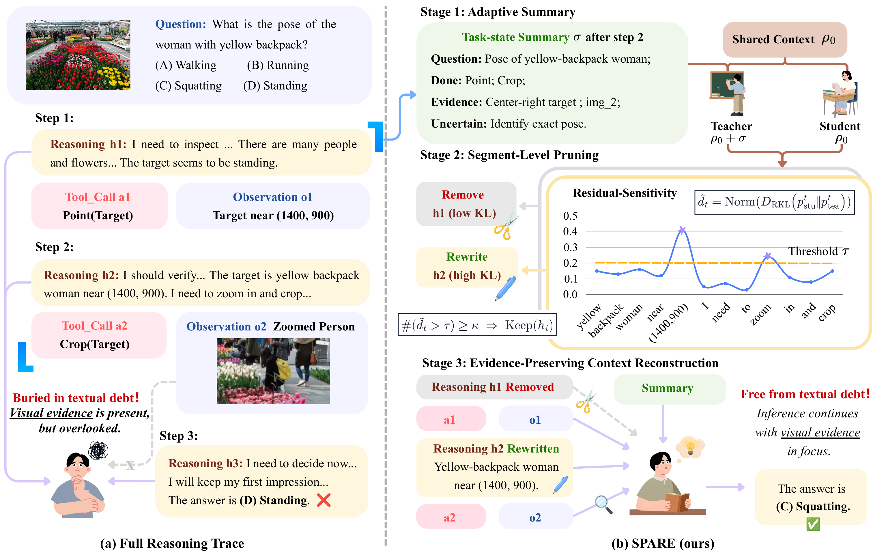

<div align="center">

# SPARE

### Buried in Textual Debt: Context Pruning with Visual Evidence Preservation for MLLM Agents

**Selective forgetting for multimodal tool-use agents.**

[](https://lukahhcm.github.io/spare/)
[](https://arxiv.org/abs/2608.22963)
[](docs/assets/paper.pdf)

<br>



</div>

## TL;DR

Long multimodal-agent trajectories accumulate self-generated plans, descriptions,
and hypotheses. This **textual debt** can draw attention away from visual evidence
and anchor later decisions to stale interpretations. SPARE uses a compact task-state
summary as temporary context for diagnosis and the next reasoning step. It measures
summary-conditioned residual sensitivity with reverse KL, removes low-sensitivity
reasoning, and extracts concise visual evidence from high-sensitivity segments
through programmatic rules. The summary is not stored in the persistent trajectory.
Tool calls, observations, and images remain unchanged.

> In the paper's aggregate trade-off comparison across **three benchmarks and three
> backbones**, SPARE achieves **50.34% accuracy**, compared with **48.81%** for Full
> Trace, while pruning **57.81%** of reasoning tokens. The main per-backbone
> evaluation covers four benchmarks, as detailed below.

## Contents

- [Method at a glance](#method-at-a-glance)
- [Results](#results)
- [Installation](#installation)
- [Quick start](#quick-start)
- [Benchmark entry points](#benchmark-entry-points)
- [Reproducing matched comparisons](#reproducing-matched-comparisons)
- [Repository layout](#repository-layout)
- [Citation](#citation)

## Method at a glance

SPARE runs inside the native multi-round tool loop:

1. **Adaptive summary.** The agent invokes `summarize_the_task` to produce a
   compact task state when it chooses to manage its reasoning history.
2. **Summary-conditioned replay.** The same backbone replays the same historical
   reasoning with and without the task-state summary. No external verifier or
   reward model is required.
3. **Residual-sensitivity scoring.** Truncated reverse KL on the student's top-K
   vocabulary is normalized within each pruning event to select reasoning segments.
4. **Evidence-preserving reconstruction.** Low-sensitivity reasoning is removed.
   Programmatic rules extract concise visual evidence from selected high-sensitivity
   segments. A selected segment is also removed if no evidence is extracted.

The summary guides the next reasoning step and is then omitted from the persistent
trajectory. Original tool calls, observations, and images remain unchanged.
Residual sensitivity is a selection heuristic, not a guarantee of semantic coverage.

### Paper configuration

| Parameter | Default | Meaning |
| --- | ---: | --- |
| `top_k` | `20` | Student vocabulary support used for reverse KL |
| `tau` | `0.2` | Normalized token-level residual-sensitivity threshold |
| `kappa` | `2` | Minimum number of high-sensitivity tokens needed to select a segment for evidence extraction |
| Trigger | model-selected | Short trajectories avoid unnecessary pruning |
| Decoder | greedy | Used for matched evaluation |

Exact policy semantics and token accounting are documented in
[`docs/METHODS.md`](docs/METHODS.md).

## Results

The main evaluation covers **GTA**, **V\***, **BLINK-Jigsaw**, and **m&m's**
(planning only). Accuracy and pruning averages below are **sample-weighted** across
these four benchmarks. All values are percentages.

| Backbone | Full Trace avg. acc. | SPARE avg. acc. | Reasoning pruned |
| --- | ---: | ---: | ---: |
| Qwen3-VL-30B-A3B-Instruct | 56.53 | **59.24** | 69.40 |
| Qwen3-VL-8B-Instruct | 64.97 | **65.29** | 61.20 |
| Llama-3.1-Nemotron-Nano-VL-8B-V1 | **35.99** | 35.35 | 41.34 |

SPARE improves average accuracy over Full Trace on both Qwen backbones. On
Nemotron, accuracy is slightly lower while 41.34% of reasoning tokens are pruned.
The three-benchmark aggregate comparison in the TL;DR uses GTA, BLINK-Jigsaw,
and m&m's and should be distinguished from this four-benchmark table.

See [detailed results](docs/RESULTS.md), the [paper PDF](docs/assets/paper.pdf),
and the [arXiv record](https://arxiv.org/abs/2608.22963).

## Installation

### Requirements

- Linux with NVIDIA GPUs for model and vision-tool serving;
- Python 3.10 or newer;
- an OpenAI-compatible endpoint that can return top-K token log probabilities;
- the official datasets and assets for the benchmark you want to run.

Benchmark toolchains have different dependencies, so we recommend one virtual
environment per benchmark rather than a single monolithic environment.

```bash
git clone https://github.com/lukahhcm/spare.git
cd spare

python -m venv .venv
source .venv/bin/activate
python -m pip install --upgrade pip

# Example: V* adapter
pip install -r benchmarks/vstar/requirements.txt
```

Dataset sources and expected local layouts are listed in
[`docs/DATA.md`](docs/DATA.md). Datasets, checkpoints, rollout traces, generated
images, logs, and credentials are intentionally excluded from Git.

## Quick start

The V* adapter evaluates five methods on one benchmark: Direct answer, Full
Trace, Delete all reasoning, Visual evidence-only, and SPARE.

First follow the [V* setup instructions](benchmarks/vstar/README.md) to prepare
the dataset manifest and start the model endpoint, controller, Point worker, and
OCR worker. Then run from the repository root:

```bash
export BASE_URL=http://127.0.0.1:8011/v1
export MODEL=qwen3-vl-8b
export CONTROLLER_ADDR=http://127.0.0.1:20001
export ITEMS_MANIFEST="$PWD/benchmarks/vstar/data/vstar/vstar.jsonl"

bash benchmarks/vstar/run_fiveway.sh
```

Set `LIMIT=2` for a smoke test before launching a complete run. The launcher
writes each method's outputs to its own subdirectory under
`benchmarks/vstar/results/`, or under the directory specified by `OUT`.

## Benchmark entry points

Each adapter preserves its benchmark's native prompt, tools, parser, and scorer.
Only the reasoning-history policy changes.

| Benchmark | Data / setup | Primary launcher | What is included |
| --- | --- | --- | --- |
| [GTA](benchmarks/gta/README.md) | [OpenCompass GTA](https://github.com/open-compass/GTA) | [`run_gta_8gpu.py`](benchmarks/gta/code/scripts/run_gta_8gpu.py) | OpenCompass adapter, sharding, fixed-set verification |
| [V*](benchmarks/vstar/README.md) | [vstar-bench](https://huggingface.co/datasets/lmms-lab/vstar-bench) | [`run_fiveway.sh`](benchmarks/vstar/run_fiveway.sh) | Visual search, Point/OCR/Crop workers, five matched methods |
| [BLINK-Jigsaw](benchmarks/jigsaw/README.md) | [BLINK](https://huggingface.co/datasets/BLINK-Benchmark/BLINK) | [`run_fiveway.sh`](benchmarks/jigsaw/run_fiveway.sh) | Jigsaw-native spatial and image-editing tools |
| [m&m's](benchmarks/mnms/README.md) | [mnms](https://huggingface.co/datasets/zixianma/mnms) | [`run_mnms_plan_v5_only.sh`](benchmarks/mnms/launchers/run_mnms_plan_v5_only.sh) | Planning-only evaluation, KL core, pruning analysis |

## Reproducing matched comparisons

The release implements five evaluation conditions:

| Condition | History policy |
| --- | --- |
| Direct answer | Answer without invoking tools |
| Full trace | Retain complete reasoning, actions, and observations |
| Delete all reasoning | Remove completed reasoning while preserving tools and observations |
| Visual evidence-only | Non-selectively extract structured visual evidence from reasoning |
| **SPARE** | Use summary-conditioned KL to select removal or evidence preservation |

For a valid comparison, keep the following fixed across conditions:

- model checkpoint, chat template, decoding parameters, and tool-round budget;
- benchmark manifest and available tool set;
- KL endpoint model, `top_k`, `tau`, and `kappa`;
- judge checkpoint, judge prompt, official parser, and scorer version.

The runners record predictions, tool traces, summary/KL events, latency, runtime
errors, and reasoning-token counts. Primary results should never use cached
answers or fabricated tool observations.

### Lightweight verification

Python modules and shell launchers can be checked without downloading datasets:

```bash
python -m compileall -q benchmarks
find benchmarks -type f -name '*.sh' -print0 | xargs -0 -n1 bash -n
```

Benchmark-specific regression commands are listed in the corresponding README.

## Repository layout

```text
spare/
├── benchmarks/
│   ├── gta/               # GTA / OpenCompass integration and 8-GPU launcher
│   ├── vstar/             # V* visual search and Point/OCR tool workers
│   ├── jigsaw/            # BLINK-Jigsaw spatial tool loop
│   └── mnms/              # m&m's planning-only evaluation
├── docs/
│   ├── index.html         # deployed project page
│   ├── DATA.md            # dataset sources and preparation
│   ├── METHODS.md         # policy definitions and pruning metric
│   └── RESULTS.md         # main results, trade-off comparison, and diagnostics
├── .github/workflows/     # GitHub Pages deployment
└── README.md
```

## Citation

If you use SPARE in your research, please cite:

```bibtex
@misc{huang2026buried,
  title = {Buried in Textual Debt: Context Pruning with Visual Evidence Preservation for MLLM Agents},
  author = {Yuchen Huang and Sijia Li and Jun Zhang and Yi R. Fung},
  year = {2026},
  eprint = {2608.22963},
  archivePrefix = {arXiv},
  primaryClass = {cs.AI},
  url = {https://arxiv.org/abs/2608.22963}
}
```
