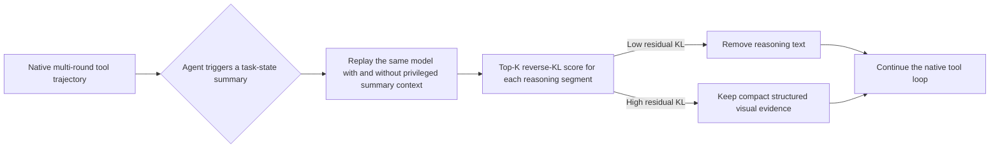

# SPARE

Official code for **Buried in Textual Debt: Context Pruning with Visual
Evidence Preservation for MLLM Agents**.

[**Project Page**](https://lukahhcm.github.io/spare/) ·
[**Paper**](https://lukahhcm.github.io/spare/assets/paper.pdf) ·
[**Documentation**](docs/METHODS.md)

SPARE is a test-time context-pruning method for multimodal tool agents. It
removes accumulated reasoning that has already served its purpose while
retaining tool calls, tool observations, images, and task-relevant visual
evidence. The goal is to reduce textual debt so later decisions rely more on
the current visual state and less on stale self-generated text.

## How SPARE works



The task-state summary is a compact diagnostic probe, not a replacement answer.
SPARE compares the same model under the original and summary-conditioned
contexts. Low-KL segments are already covered by the compact state and can be
removed. High-KL segments retain concise evidence such as OCR strings,
coordinates, crop identifiers, values, and candidate relations. The action
blocks and external observations are never pruned.

The default paper setting uses student top-20 reverse KL, normalized within
each pruning event, with `tau=0.2` and `kappa=2`. Summarization is gated by the
trajectory state, so short episodes avoid unnecessary pruning work.

## Evaluation protocol

We compare five conditions under each benchmark's native prompt, parser, tools,
and scorer:

| Condition | Context policy |
| --- | --- |
| Direct answer | Answer without tools |
| Full trace | Use tools and retain all reasoning |
| Delete all reasoning | Remove completed reasoning, keep actions and observations |
| Visual evidence-only | Rewrite every reasoning segment as structured visual evidence |
| SPARE | Use summary-conditioned KL to select deletion or evidence preservation |

The paper evaluates Qwen3-VL-8B-Instruct, Qwen3-VL-30B-A3B-Instruct, and
Llama-3.1-Nemotron-Nano-VL-8B-V1. Across the reported settings, SPARE gives the
best average accuracy among pruning methods while removing 37.89 to 64.58
percent of reasoning tokens. Full tables and ablations are provided in the
paper.

## Repository layout

```text
spare/
├── benchmarks/
│   ├── visualtoolbench/   # VTB rollout, KL pruning, scoring, token accounting
│   ├── mnms/              # m&m's plan and tool execution
│   ├── gta/               # GTA and OpenCompass adapter
│   ├── vstar/             # V* visual search and Point worker
│   └── jigsaw/            # BLINK-Jigsaw tool loop
├── docs/
│   ├── DATA.md            # dataset sources and expected local layout
│   ├── METHODS.md         # exact method definitions and pruning metric
│   └── RESULTS.md         # release-level result note
└── README.md
```

Benchmark-specific code stays separate because the tools and official scoring
protocols differ. The five inference conditions and SPARE decision rule are
kept consistent.

## Quick start

Use separate environments for model serving and evaluation. Serve the VLM and
the logprob-capable KL endpoint through an OpenAI-compatible API, then install
the adapter requirements. For VisualToolBench:

```bash
python -m venv .venv
source .venv/bin/activate
pip install -r benchmarks/visualtoolbench/requirements.txt

export DATA_PATH=/path/to/visualtoolbench_eval.parquet
export MANIFEST_PATH=/path/to/evaluation_manifest.json
export OUT_ROOT=/path/to/outputs/vtb
export BASE_URL=http://127.0.0.1:8000/v1
export MODEL_NAME=Qwen3-VL-8B-Instruct
export KL_BASE_URL=http://127.0.0.1:8001/v1
export KL_MODEL=Qwen3-VL-8B-Instruct

bash benchmarks/visualtoolbench/run_4controls.sh
bash benchmarks/visualtoolbench/run_spare.sh

export PRED_ROOT="$OUT_ROOT"
export ANCHORS_PATH=/path/to/anchor_records.jsonl
export JUDGE_BASE_URL=http://127.0.0.1:8012/v1
export JUDGE_MODEL=Qwen3-VL-30B-A3B-Instruct
bash benchmarks/visualtoolbench/score_all.sh
```

Dataset preparation for every benchmark is documented once in
[`docs/DATA.md`](docs/DATA.md). Exact method semantics and token accounting are
in [`docs/METHODS.md`](docs/METHODS.md). Raw datasets, checkpoints, generated
images, rollout traces, logs, and credentials are intentionally excluded from
Git.

## Reproducibility

Keep the following fixed for a matched comparison:

- temperature, sampling policy, maximum output tokens, and tool-round budget;
- the model prompt template and visible reasoning format;
- native benchmark tool availability and transport;
- KL endpoint model, `top_k`, `tau`, and `kappa`;
- evaluation manifest, judge model, judge prompt, and scorer version.

The included runners record predictions, tool traces, summary/KL events,
latency, runtime errors, and reasoning-token counts. No cached-answer or fake
tool-observation fallback should be used for a primary result.

## Citation

Please cite the paper if you use SPARE. Benchmark datasets and copied framework
components retain their original licenses and citation requirements.
